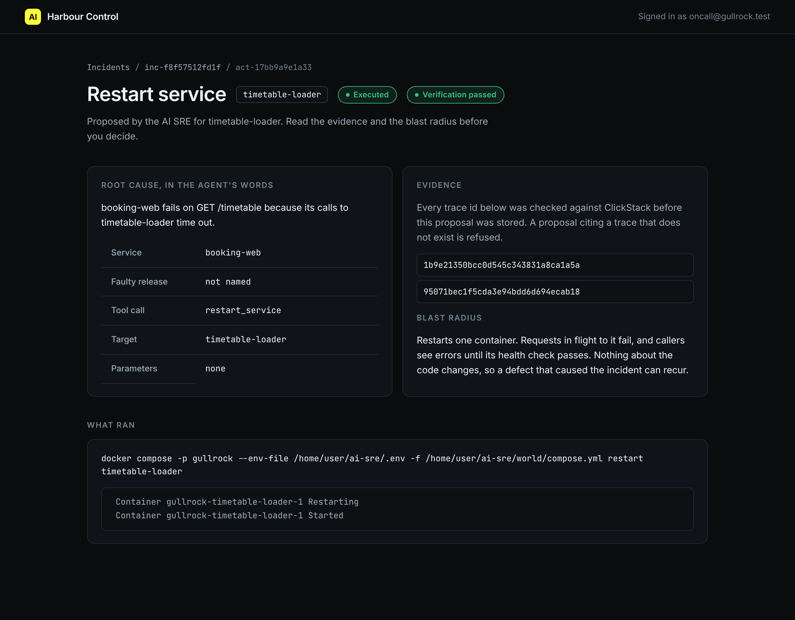

# Edit the wrong fix

## The problem

Sometimes the AI SRE proposes the wrong fix. It blames the service where the errors show up, not the service that causes them. If you approve it, a change runs, nothing gets better, and the real fault keeps hurting passengers.

In timetable-hang, two requests make timetable-loader build a tide table forever. booking-web waits for timetable-loader, times out, and logs `timetable-loader did not answer`. An AI SRE that reads only booking-web logs blames booking-web.

You do not have to choose between yes and no. You can reject the proposal with a reason, edit it into the right change, and approve that. The audit log keeps every decision, in order.

For example, the recorded timetable-hang incident shows these decisions for one action:

```text
remediation_proposed   ai-sre                 rollback_release booking-web
remediation_rejected   oncall@gullrock.test   rolling back booking-web cannot stop a hang in timetable-loader
remediation_edited     oncall@gullrock.test   restart_service timetable-loader
remediation_approved   oncall@gullrock.test
remediation_executed   ai-sre
verification_passed    harbour-control        stuck requests: 0
```



## Your challenge

1. Heal the world, then plant the fault. Wait until Harbour Control shows a `stuck_requests` incident for timetable-loader.

```bash
bun run world heal
bun run world break timetable-hang
```

Expect: `Healed:` and then `Sent two requests for a long tide range; they are now hanging inside timetable-loader.`

2. Let the AI SRE investigate. With no key, it plays back a recorded run that makes this mistake:

```bash
bun parts/05-ask-before-you-act/ai-sre.ts timetable-hang
```

Expect: a `propose_remediation` line with an `action_id`, and `I proposed rolling booking-web back to v1.`

3. Open that action in Harbour Control. Write why it is wrong in the reason box, and press Reject.
4. Use Edit to change it to `restart_service` on `timetable-loader`. Then press Approve.
5. Run the edited change. Put your own `action_id` in place of `act-...`:

```bash
bun parts/05-ask-before-you-act/call-tool.ts execute_remediation '{"action_id": "act-..."}'
```

Expect: one JSON reply with your `action_id` and `"exit_code":0`.

6. Fill in `decision.md` in this folder: the `Action id` and one sentence for `Why I rejected`.

## Done when

- `decision.md` names the AI SRE's proposal for the timetable-hang incident.
- You rejected it with a reason.
- The decisions are in this order: proposed, rejected, edited, approved, executed.
- The change that ran is `restart_service timetable-loader`, and harbour-control verified recovery.

```bash
bun run verify edit-the-wrong-fix
```

Expect: `Done. All 7 rules pass.` and a `Progress:` line.

## If you get stuck

Saying no is half the job. For example, the wrong answer `rejected-and-stopped` rejected the rollback but never edited it. The check prints:

```text
  FAIL  the order is proposed, rejected, edited, approved, executed
        Try next: after Reject, use Edit to change the action, then Approve, then run it once with call-tool.ts execute_remediation
```

| What you see                        | Fix                                                                  |
| ----------------------------------- | -------------------------------------------------------------------- |
| No incident opens                   | Wait 30 seconds. A request counts as stuck after 20 seconds.         |
| `FAIL the AI SRE first proposed...` | Use the proposal from `ai-sre.ts`, not one you sent yourself.        |
| `verification_failed`               | The approved change did not stop the hang. Restart timetable-loader. |

## Words you will use

- **Reject**: say no to a proposal, with a reason the audit log keeps.
- **Edit**: change the action of a rejected proposal. It goes back to pending.
- **Victim service**: a service that shows errors because another service it calls is broken.
