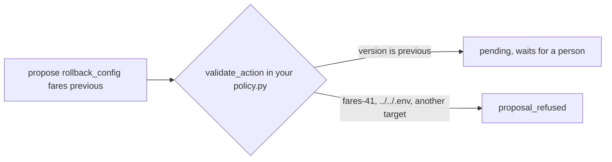

# Add the config rollback

## The problem

Not every outage comes from new code. Some come from a config push: a file that every server reads at once. If the file is bad, everything breaks together.

In fare-file-push, someone pushes fare table `fares-42`. It holds every row twice. booking-web refuses a table over 256 rows, every price reads as zero, and bookings fail.

The fix is to put back the previous fare table. But the fixed list of actions in your `policy.py` has no action for that. You add it. A new action is a new power for the AI SRE, so it needs three things:

- the narrowest rule that works: it may only put back the previous table, never a file the agent names;
- blast radius text, so the approver sees who is affected;
- a test that proves both.

For example, without the rule, a proposal for `rollback_config` is refused:

```text
proposal refused: action 'rollback_config' is not allowed; allowed: ['restart_service', 'rollback_release']
```



## Your challenge

1. Open `policy.py` in this folder. It is harbour-control's policy without `rollback_config`.
2. Add `rollback_config` to `ACTIONS`, with one target, `fares`, and one parameter, `version`. The only allowed value is `previous`.
3. Add `fares` to `TARGETS`, and a `rollback_config` entry to `BLAST_RADIUS`. Say what changes for passengers and what is lost.
4. Write tests in `test_rollback_config.py` that call `validate_action`. Test what it allows and what it refuses.
5. Run harbour-control with your policy, and resolve the fault through it:

```bash
bun parts/05-ask-before-you-act/deploy-policy.ts
bun run world break fare-file-push
```

Expect: `harbour-control is running your policy.py.` and then `Pushed fare table fares-42 to booking-web.`

6. Send a finding (change kind `config`, value `fares-42`) and propose `rollback_config` on `fares` with `{"version": "previous"}`. Approve it and run it.
7. Write `Incident id: inc-...` in `incident.md` in this folder.

## Done when

- Your policy allows `rollback_config fares previous`, and refuses a named file, a path and any other target.
- `BLAST_RADIUS` and `TARGETS` describe the new action.
- Your tests pass on your policy and fail on the starter policy. Every harbour-control test passes.
- The fare-file-push incident resolved through `rollback_config`.

```bash
bun run verify add-the-config-rollback
```

Expect: `Done. All 9 rules pass.` and a `Progress:` line.

## If you get stuck

The rule must be narrow. For example, the wrong answer `any-version-allowed` also allows `fares-41` and `fares-42`. Then the agent can choose a file. The check prints:

```text
  FAIL  it refuses an unknown file: a named fare file, or a path
        Try next: allow only the value "previous". An agent that may name any file can load a broken one
```

| What you see                                              | Fix                                                                            |
| --------------------------------------------------------- | ------------------------------------------------------------------------------ |
| `harbour-control did not start with this policy.`         | Run `bun parts/05-ask-before-you-act/deploy-policy.ts off`, then fix the file. |
| `FAIL your test ... fails on the policy you started from` | Your test checks nothing new. Call `validate_action` for `rollback_config`.    |
| `FAIL every harbour-control test passes`                  | Read the first failing test. The runner tests use `rollback_config` too.       |

## Words you will use

- **Config push**: a change to a file that services read, with no new code.
- **Policy**: the fixed list of actions, targets and params that harbour-control may run.
- **Narrow rule**: a rule that allows only the one value that is needed.
