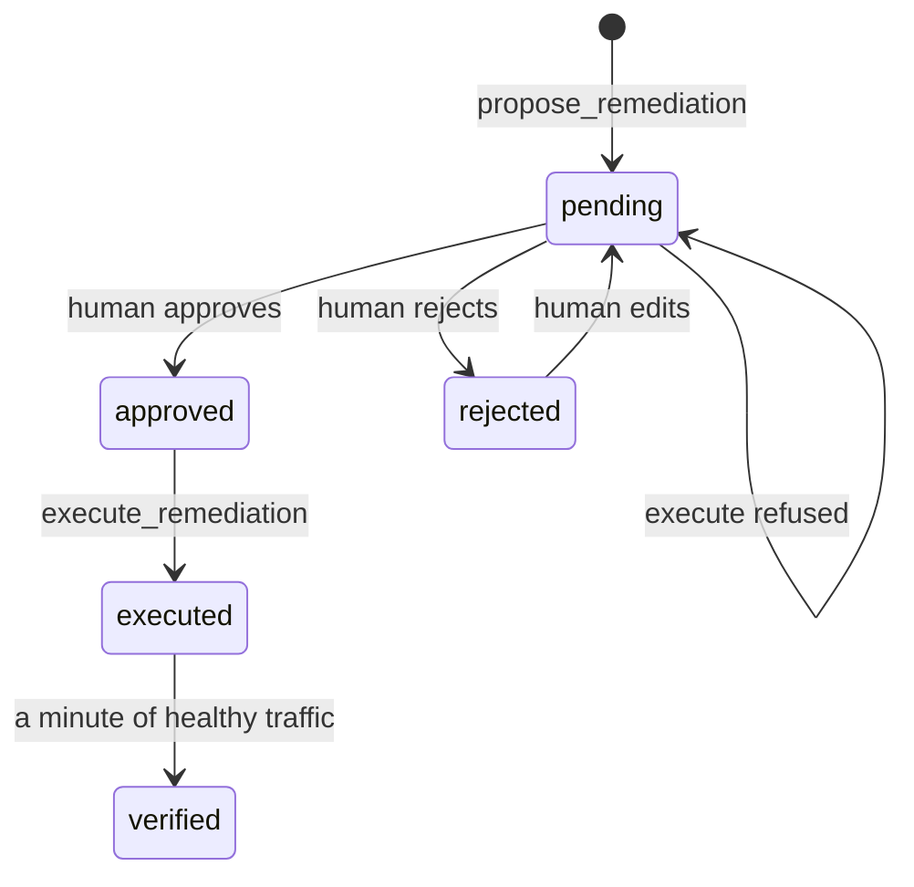

# Ask before you act

## The problem

Most large outages follow a change, and the worst ones come from automation that acted at once. The learner builds the stop: one proposed change against a stored finding, a named human approval, a fixed list of actions with their blast radius, and a check on fresh traffic.

Why it matters: TODO(part session): cite a company's own page with its number, read on the day (the research brief proposes Knight Capital, CrowdStrike and AWS us-east-1; none could be read on the build date).



## Steps

| Step                        | Minutes | You produce                                                           | The check reads                                                                      |
| --------------------------- | ------- | --------------------------------------------------------------------- | ------------------------------------------------------------------------------------ |
| `propose-one-change`        | 15      | a propose_remediation call from your agent                            | one pending proposal for a stored finding, inside the action list                    |
| `refuse-without-approval`   | 10      | an attempt to run the change before approval                          | a remediation_refused row and the same booking-web image as before                   |
| `approve-with-blast-radius` | 15      | your approval after reading evidence and blast radius                 | a remediation_approved row naming the approver, after the pending row                |
| `roll-back-the-release`     | 15      | the approved rollback, run and verified                               | executed then verification_passed rows; the footer reads Release v1                  |
| `edit-the-wrong-fix`        | 20      | for timetable-hang: reject the rollback, edit to a restart, approve   | event order pending, rejected, pending, approved, executed; timetable-loader healthy |
| `add-the-config-rollback`   | 25      | rollback_config in the action list, with blast radius text and a test | policy test passes, an unknown file is refused, fare-file-push resolves through it   |

## Walkthrough

TODO(part session): the step folders, their checks and these commands are built in this part's own session.

```bash
bun run verify part ask-before-you-act
```

Expect: `Part ask-before-you-act is done: 0/0 steps pass.` until the part session adds the steps.

```bash
bun run verify propose-one-change
```

Expect: TODO(part session): the pass line of `propose-one-change`.

```bash
bun run verify refuse-without-approval
```

Expect: TODO(part session): the pass line of `refuse-without-approval`.

```bash
bun run verify approve-with-blast-radius
```

Expect: TODO(part session): the pass line of `approve-with-blast-radius`.

```bash
bun run verify roll-back-the-release
```

Expect: TODO(part session): the pass line of `roll-back-the-release`.

```bash
bun run verify edit-the-wrong-fix
```

Expect: TODO(part session): the pass line of `edit-the-wrong-fix`.

```bash
bun run verify add-the-config-rollback
```

Expect: TODO(part session): the pass line of `add-the-config-rollback`.
