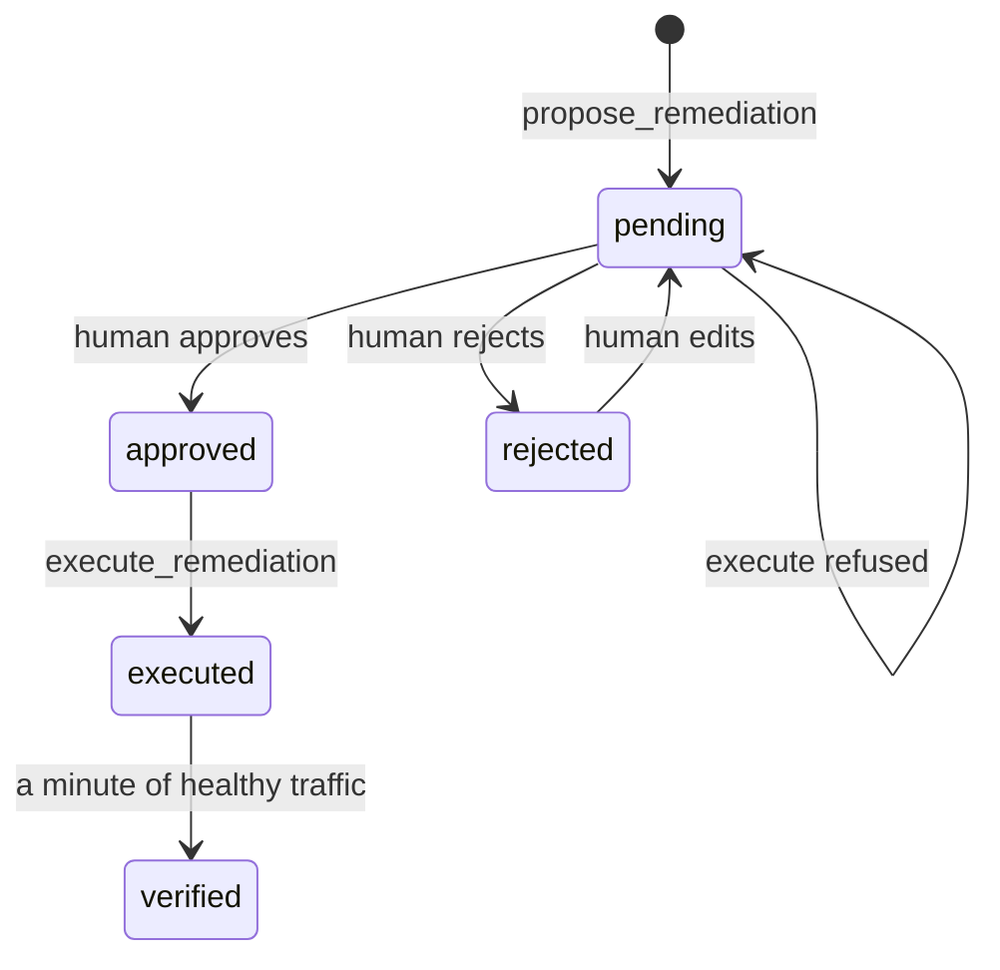

# Ask before you act

## The problem

Most large outages follow a change. The worst ones come from automation that acted at once, with no person in the loop.

In this part you build the stop. It has four pieces:

- **One proposed change.** The AI SRE proposes one fix, tied to a stored finding.
- **A named human approval.** A person says yes, and the audit log records their name.
- **A fixed list of actions.** The AI can only propose actions on this list. Each action shows its blast radius. The blast radius is what else breaks, or who is affected, when the action runs.
- **A check on fresh traffic.** After the fix, harbour-control watches new requests to confirm that the service is healthy again.

For example, this is the blast radius text for `rollback_release`, from `world/harbour-control/harbour_control/policy.py`. The approver reads it before saying yes:

```text
Redeploys booking-web on the previous image. The booking page returns errors for the few seconds
the container takes to pass its health check, so passengers mid-booking must try again. Anything
shipped in the newer release is withdrawn until it is fixed and deployed again.
```

And here is the real order of events in the audit log of the recorded bad-release morning, shortened:

```text
04:24:59.851  remediation_proposed   ai-sre                rollback_release booking-web to v1
04:24:59.958  remediation_refused    ai-sre                state: pending
04:25:06.533  remediation_approved   oncall@gullrock.test
04:25:22.623  remediation_executed   ai-sre
04:26:31.682  verification_passed    harbour-control       error rate 0.0 over 207 requests
```

The AI tried to run the fix before approval, and harbour-control refused. It ran only after a person approved it.

Why it matters: TODO(part session). Cite a company's own page with its number, read on the day. The research brief proposes Knight Capital, CrowdStrike and AWS us-east-1. None of them could be read on the build date.

This picture shows the states of one proposed change:



## Steps

| Step                        | Minutes | You produce                                                           | The check reads                                                                      |
| --------------------------- | ------- | --------------------------------------------------------------------- | ------------------------------------------------------------------------------------ |
| `propose-one-change`        | 15      | a propose_remediation call from your agent                            | one pending proposal for a stored finding, inside the action list                    |
| `refuse-without-approval`   | 10      | an attempt to run the change before approval                          | a remediation_refused row and the same booking-web image as before                   |
| `approve-with-blast-radius` | 15      | your approval after reading evidence and blast radius                 | a remediation_approved row naming the approver, after the pending row                |
| `roll-back-the-release`     | 15      | the approved rollback, run and verified                               | executed then verification_passed rows; the footer reads Release v1                  |
| `edit-the-wrong-fix`        | 20      | for timetable-hang: reject the rollback, edit to a restart, approve   | event order pending, rejected, pending, approved, executed; timetable-loader healthy |
| `add-the-config-rollback`   | 25      | rollback_config in the action list, with blast radius text and a test | policy test passes, an unknown file is refused, fare-file-push resolves through it   |

## Walkthrough

TODO(part session): this part's own session builds the step folders, their checks and these commands.

This command checks the whole part. It has no steps yet.

```bash
bun run verify part ask-before-you-act
```

Expect: `Part ask-before-you-act is done: 0/0 steps pass.` until the part session adds the steps.

```bash
bun run verify propose-one-change
```

Expect: TODO(part session): the pass line of `propose-one-change`.

```bash
bun run verify refuse-without-approval
```

Expect: TODO(part session): the pass line of `refuse-without-approval`.

```bash
bun run verify approve-with-blast-radius
```

Expect: TODO(part session): the pass line of `approve-with-blast-radius`.

```bash
bun run verify roll-back-the-release
```

Expect: TODO(part session): the pass line of `roll-back-the-release`.

```bash
bun run verify edit-the-wrong-fix
```

Expect: TODO(part session): the pass line of `edit-the-wrong-fix`.

```bash
bun run verify add-the-config-rollback
```

Expect: TODO(part session): the pass line of `add-the-config-rollback`.
