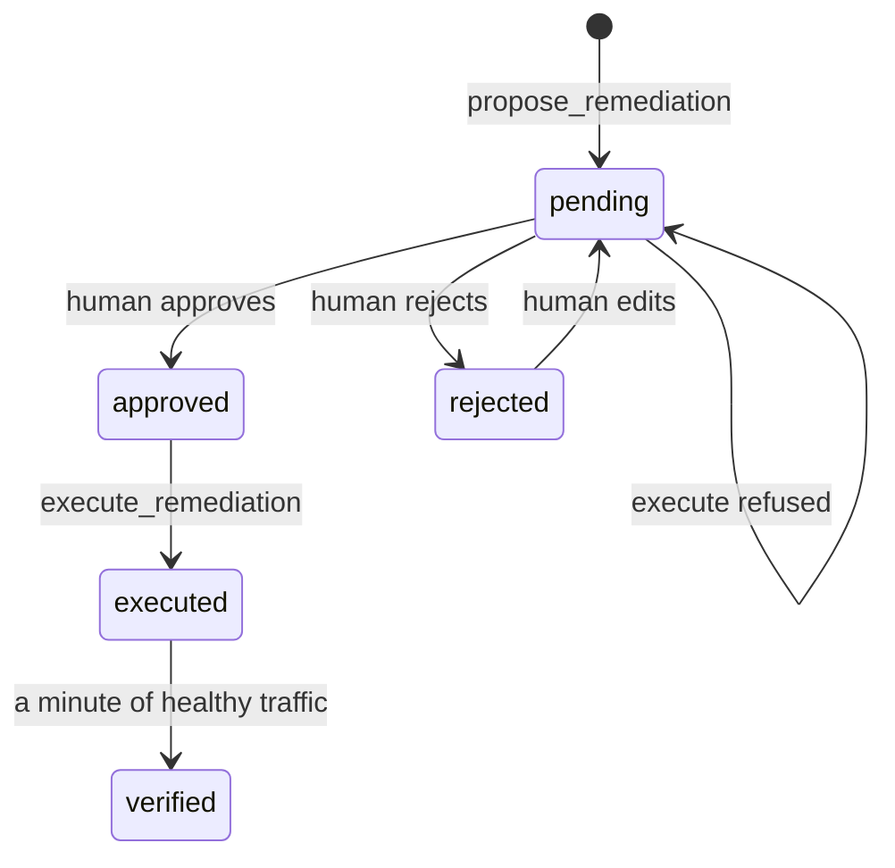

# Ask before you act

## The problem

Most large outages follow a change. The worst ones come from automation that acted at once, with no person in the loop.

In this part you build the stop. It has four pieces:

- **One proposed change.** The AI SRE proposes one fix, tied to a stored finding.
- **A named human approval.** A person says yes, and the audit log records their name.
- **A fixed list of actions.** The AI can only propose actions on this list. Each action shows its blast radius. The blast radius is what else breaks, or who is affected, when the action runs.
- **A check on fresh traffic.** After the fix, harbour-control watches new requests to confirm that the service is healthy again.

For example, this is the blast radius text for `rollback_release`, from `world/harbour-control/harbour_control/policy.py`. The approver reads it before saying yes:

```text
Redeploys booking-web on the previous image. The booking page returns errors for the few seconds
the container takes to pass its health check, so passengers mid-booking must try again. Anything
shipped in the newer release is withdrawn until it is fixed and deployed again.
```

And here is the real order of events in the audit log of the recorded bad-release morning, shortened:

```text
04:24:59.851  remediation_proposed   ai-sre                rollback_release booking-web to v1
04:24:59.958  remediation_refused    ai-sre                state: pending
04:25:06.533  remediation_approved   oncall@gullrock.test
04:25:22.623  remediation_executed   ai-sre
04:26:31.682  verification_passed    harbour-control       error rate 0.0 over 207 requests
```

The AI tried to run the fix before approval, and harbour-control refused. It ran only after a person approved it.

Why it matters: in this world, the wrong fix is cheap to make. For example, on a recorded bad-release morning, an approved restart of booking-web ran with exit code 0. The errors went on. After five minutes, harbour-control wrote `verification_failed`. A change that "worked" fixed nothing. Only the rollback, approved by a person and checked on fresh traffic, closed the incident.

This picture shows the states of one proposed change:



## Steps

| Step                        | Minutes | You produce                                                           | The check reads                                                                      |
| --------------------------- | ------- | --------------------------------------------------------------------- | ------------------------------------------------------------------------------------ |
| `propose-one-change`        | 15      | a propose_remediation call from your agent                            | one pending proposal for a stored finding, inside the action list                    |
| `refuse-without-approval`   | 10      | an attempt to run the change before approval                          | a remediation_refused row and the same booking-web image as before                   |
| `approve-with-blast-radius` | 15      | your approval after reading evidence and blast radius                 | a remediation_approved row naming the approver, after the pending row                |
| `roll-back-the-release`     | 15      | the approved rollback, run and verified                               | executed then verification_passed rows; the footer reads Release v1                  |
| `edit-the-wrong-fix`        | 20      | for timetable-hang: reject the rollback, edit to a restart, approve   | event order pending, rejected, pending, approved, executed; timetable-loader healthy |
| `add-the-config-rollback`   | 25      | rollback_config in the action list, with blast radius text and a test | policy test passes, an unknown file is refused, fare-file-push resolves through it   |

Every check reads the rows that harbour-control wrote, never what a model said. Your files only hold the ids.

## Walkthrough

You send the AI SRE's calls with your own MCP client, or with `call-tool.ts`. It is a small MCP client in this part folder. It needs no model key. You make the human decisions in Harbour Control at http://localhost:8090.

Start the world, if it is not running, and plant the bad release.

```bash
bun run world
bun run world break bad-release
```

Expect: `The world is up: every service is healthy.` and then `Planted bad-release.`

When the incident opens, fill in `01-propose-one-change/problem/finding.json` and send it. Then fill in `change.json` with the `finding_id` and send that.

```bash
bun parts/05-ask-before-you-act/call-tool.ts submit_finding parts/05-ask-before-you-act/01-propose-one-change/problem/finding.json
bun parts/05-ask-before-you-act/call-tool.ts propose_remediation parts/05-ask-before-you-act/01-propose-one-change/problem/change.json
```

Expect: `Wrote finding_id fnd-` and then `Wrote action_id act-`, each with twelve characters.

```bash
bun run verify propose-one-change
```

Expect: `Done. All 6 rules pass.`

Copy the `action_id` into `02-refuse-without-approval/problem/run.json`, and try to run it before anyone approves.

```bash
bun parts/05-ask-before-you-act/call-tool.ts execute_remediation parts/05-ask-before-you-act/02-refuse-without-approval/problem/run.json
bun run verify refuse-without-approval
```

Expect: `REFUSED  execute_remediation:` with `a human must approve it`, then `Done. All 4 rules pass.`

Read the approval page, fill in `03-approve-with-blast-radius/problem/approval.md`, and approve.

```bash
bun run approve --yes
bun run verify approve-with-blast-radius
```

Expect: `Approved act-` with your action id, then `Done. All 5 rules pass.`

Copy the same `action_id` into `04-roll-back-the-release/problem/run.json` and run it. Wait about 90 seconds for the check on fresh traffic.

```bash
bun parts/05-ask-before-you-act/call-tool.ts execute_remediation parts/05-ask-before-you-act/04-roll-back-the-release/problem/run.json
```

Expect: `"exit_code":0` and `Recovery is verified automatically over the next minute`.

```bash
bun run verify roll-back-the-release
```

Expect: `Done. All 5 rules pass.` once harbour-control has written `verification_passed`.

Now the wrong fix. Plant timetable-hang and let the replayed AI SRE propose.

```bash
bun run world heal
bun run world break timetable-hang
bun parts/05-ask-before-you-act/ai-sre.ts timetable-hang
```

Expect: `Healed:`, then `Planted timetable-hang.`, then `I proposed rolling booking-web back to v1.`

Reject it in Harbour Control, edit it to `restart_service` on `timetable-loader`, approve it, and run it with `call-tool.ts execute_remediation`. Write `05-edit-the-wrong-fix/problem/decision.md`.

```bash
bun run verify edit-the-wrong-fix
```

Expect: `Done. All 7 rules pass.`

Last, add `rollback_config` to `06-add-the-config-rollback/problem/policy.py`, with its tests. Then run harbour-control with your policy and plant the fare push.

```bash
bun parts/05-ask-before-you-act/deploy-policy.ts
bun run world heal
bun run world break fare-file-push
```

Expect: `harbour-control is running your policy.py.`, then `Healed:`, then `Pushed fare table fares-42 to booking-web.`

Send a finding and a `rollback_config` proposal, approve it, run it, and write the incident id in `incident.md`.

```bash
bun run verify add-the-config-rollback
```

Expect: `Done. All 9 rules pass.`

Put the course policy back, and check the whole part.

```bash
bun parts/05-ask-before-you-act/deploy-policy.ts off
bun run verify part ask-before-you-act
```

Expect: `harbour-control is running the course's own policy.` and then `Part ask-before-you-act is done: 6/6 steps pass.`

## Assignment

The problem: automation acted at once, and made the outage bigger.

Hand in these files from your repo:

- the six step folders' `problem/` files: `change.json`, `run.json`, `approval.md`, `decision.md`, `incident.md`;
- your `policy.py` with `rollback_config`, and `test_rollback_config.py`.

The rubric. Each line is yes or no:

| #   | Yes when                                                                                      |
| --- | --------------------------------------------------------------------------------------------- |
| 1   | `bun run verify edit-the-wrong-fix` passes: proposed, rejected, edited, approved, executed.   |
| 2   | `bun run verify add-the-config-rollback` passes: your tests pass, an unknown file is refused. |
| 3   | No `remediation_executed` row in your audit log comes before an approval of the same action.  |
| 4   | Your blast radius text for `rollback_config` says who is affected and what is lost.           |
| 5   | Your `Why I rejected` names the service that really hangs.                                    |

For advanced learners: require a second approver for any action whose blast radius covers every route, such as `rollback_config`. Add a test that one approval is not enough.

## Finished

You now have the stop. The AI SRE proposes one change for a stored finding. It cannot run it alone, and the refusal is written down. A named person reads the evidence and the blast radius, then says yes, no, or "not this, that". Every change comes from a fixed list that you can extend, with a test. harbour-control closes an incident only when fresh traffic proves the fix.

Next, in write-it-down, you turn this audit log into a blameless postmortem. Every line of its timeline must match a row you made in this part.
