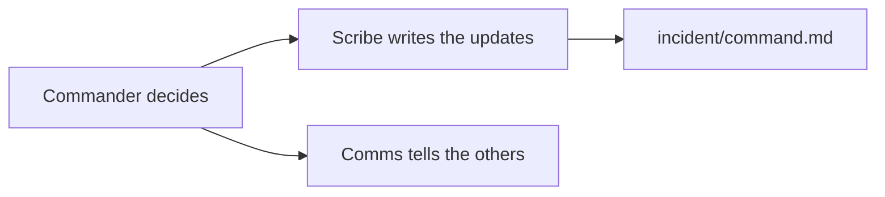

# Run the incident command

## The problem

During an incident, three people often do the same job and nobody does the notes. Passengers wait while the team talks over each other. One person leads, one writes, and one tells everyone else what is going on. For example, at 22:17 Asha leads, Ben writes, and Chen tells the front desk.



## Watch it done

Open `incident/command.md` in the `solution` folder of this step. Three names sit on three roles. The state is three short lines. The updates read in time order, and one says what the team does not know yet.

## Your challenge

Open `incident/command.md` in this folder.

1. Give each of the three roles to a different person. Write one name after each.
2. Fill in `Status:`, `Impact:` and `Next update:` as a short state note.
3. Under `## Updates`, add at least three lines. Start each with a dash and a time.
4. Make one update say what you do not know yet.

```bash
bun run verify run-the-incident-command
```

Expect: `Done. All 8 rules pass.` and a `Progress:` line.

## Do it on your work

Use the same file for the next real page on your own team. Pick the three people before you open any dashboard. Good looks like this: the next update time is on the page, and it is kept.

## Done when

- Three different people hold the Commander, Scribe and Comms roles.
- The state has a status, an impact and a time for the next update.
- There are three updates in time order, and one says what is not known yet.

## If you get stuck

| What you see                                       | Fix                                                                     |
| -------------------------------------------------- | ----------------------------------------------------------------------- |
| `FAIL three different people hold the three roles` | Give each role to a different person.                                   |
| `FAIL there are at least three updates`            | Each line needs a dash, a time such as `22:17`, and four words or more. |
| `FAIL the updates are in time order`               | Put the oldest update first.                                            |

## Words you will use

- **Commander**: the one person who decides. They do not type the notes.
- **Scribe**: the person who writes down what happens and when.
- **Comms**: the person who tells everyone outside the room.
- **State note**: a few lines that show the status, the impact and when the next update comes.
