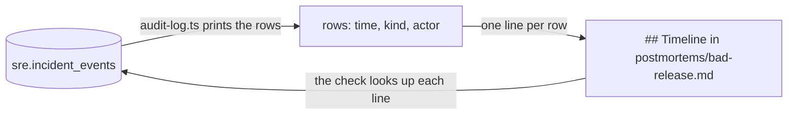

# Draft the timeline

## The problem

The bad release is over. Bookings work again. Now the team asks: what happened, and when?

People remember an incident in the wrong order, and remember steps that never happened. A timeline from memory starts arguments, not fixes.

Gullrock already has a better source. harbour-control writes one row to its audit log for every step of an incident. The audit log is the table `sre.incident_events`. So the timeline comes from the rows, and every line points at one row.

For example, these are three rows of the recorded bad-release incident `inc-b1182f037ed0`:

```text
22:17:52  incident_opened       detector              booking-web error rate 10% over the last minute
22:18:08  remediation_approved  oncall@gullrock.test
22:18:24  remediation_executed  ai-sre                rollback_release booking-web
```

They become these three timeline lines:

```text
- 22:17:52 incident_opened: the detector paged on-call; the booking-web error rate was 10%.
- 22:18:08 remediation_approved: the on-call engineer read the evidence and approved the rollback.
- 22:18:24 remediation_executed: the rollback ran; booking-web restarted on release v1.
```



## Your challenge

Open `postmortems/bad-release.md` in this folder.

1. Find your incident. This command lists the newest ones:

```bash
bun parts/06-write-it-down/audit-log.ts
```

Expect: a list of incident ids, such as `inc-b1182f037ed0`, with the time each one opened.

2. Print its rows. Use your own incident id:

```bash
bun parts/06-write-it-down/audit-log.ts inc-b1182f037ed0
```

Expect: `Incident inc-b1182f037ed0: 8 audit rows (times are UTC)` and one line per row.

3. Write the id on the `Incident:` line.
4. Under `## Timeline`, write one line per event: a dash, the time, the event kind, a colon, and what happened in plain words.

You can ask your AI SRE to draft the lines from the rows. Then read each line against its row.

## Done when

- The file names an incident that is in the audit log.
- The timeline has at least five lines, in time order.
- Every line has the same second and the same event kind as one audit row.
- The page, the finding, the approval, the change and the recovery each have a line.
- Every line has four words or more after the colon.

```bash
bun run verify draft-the-timeline
```

Expect: `Done. All 7 rules pass.` and a `Progress:` line.

## If you get stuck

| What you see                                    | Fix                                                                                                |
| ----------------------------------------------- | -------------------------------------------------------------------------------------------------- |
| `FAIL every timeline line matches an audit row` | Use the UTC times that `audit-log.ts` prints, not your own clock. Delete any line that has no row. |
| `FAIL the incident is in the audit log`         | Copy the id from `audit-log.ts`. It starts with `inc-` and has 12 more characters.                 |
| `the world is not running`                      | Start it with `bun run world`. Or use the recording, as below.                                     |

No world on your machine? Write the word `bad-release` in a file called `recorded-world.txt` in this folder. The check then reads the recorded morning. Add `--recorded` to the `audit-log.ts` commands to see the same rows.

## Words you will use

- **Postmortem**: a short written report after an incident. It says what happened, what it cost and what changes next.
- **Timeline**: the list of events of an incident, oldest first, each with its time.
- **Audit log**: a table that only grows. Each row records one step. Nobody edits old rows.
- **UTC**: the world clock that servers use. Your local clock may be one or more hours away from it.
