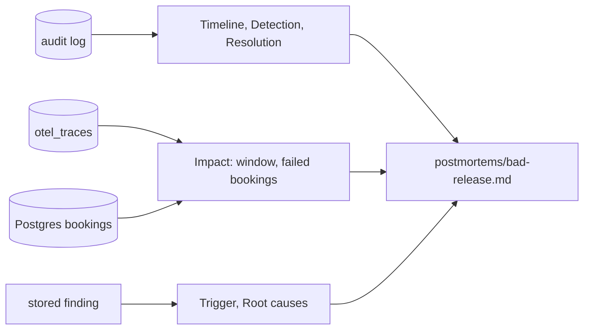

# Write the postmortem

## The problem

You have a timeline. Now the team needs the whole story: what it cost, why it happened, and what changes next.

Two things often go wrong in a postmortem. First, the numbers are guesses: "about 150 bookings failed". Second, it names a person as the cause: "the approver did not test it". A guess can be wrong. A name makes people hide what they did next time. So a good postmortem is **blameless**: it names causes in the system, and it takes every number from data.

For example, this is the Impact section of the recorded bad-release incident. Every number comes from a record:

```text
Impact started: 22:10:35      the first span of release v2 (traces)
Impact ended: 22:18:24        the remediation_executed row (audit log)
Failed bookings: 131          POST /api/bookings spans with an error (traces)
Bookings confirmed: 513       rows in the bookings table (Postgres)
```

Look at the start time. The page came at 22:17:52, but the impact started more than seven minutes earlier, when v2 went live. The impact starts at the change, not at the page.



## Your challenge

Open `postmortems/bad-release.md` in this folder. Fill in every section of the starter.

1. Put your incident id on the `Incident:` line, and copy your timeline from `draft-the-timeline`.
2. Get the Impact numbers. Use your own incident id:

```bash
bun parts/06-write-it-down/audit-log.ts inc-b1182f037ed0
```

Expect: an `Impact window:` line, then `Failed bookings: 131` and `Bookings confirmed: 513` for the recorded incident.

3. Write `Impact started:`, `Impact ended:`, `Failed bookings:` and `Bookings confirmed:` with those values.
4. Under Trigger, name the service and the release. Under Root causes, say what in the system let it happen.
5. Write what went well, what went wrong, and at least two action items.

Your AI SRE can draft the sections from the finding and the rows. You check every sentence.

## Done when

- The incident was fixed by an approved change, and every section is there.
- The Impact window and both counts match the records.
- Trigger names the service and the release.
- Root causes names no person, no email, and no words like "careless" or "should have".
- Action items has at least two lines.

```bash
bun run verify write-the-postmortem
```

Expect: `Done. All 8 rules pass.` and a `Progress:` line.

## If you get stuck

| What you see                                   | Fix                                                                                            |
| ---------------------------------------------- | ---------------------------------------------------------------------------------------------- |
| `FAIL Impact gives the window`                 | Start at the first span of the bad release, not at the page. `audit-log.ts` prints both times. |
| `FAIL Impact counts the failed bookings`       | Copy the number. Never round it.                                                               |
| `FAIL Root causes names a cause in the system` | Ask "what let a person make this mistake?" Write that answer instead of the person.            |

No world on your machine? Write `bad-release` in `recorded-world.txt` in this folder, and add `--recorded` to the `audit-log.ts` command.

## Words you will use

- **Blameless**: a postmortem that names causes in the system, never a person to blame.
- **Impact**: what the incident cost the business. Here, the bookings that failed.
- **Trigger**: the change that set the incident off. It is not always the root cause.
- **Root cause**: the weakness in the system that let the trigger do harm.
