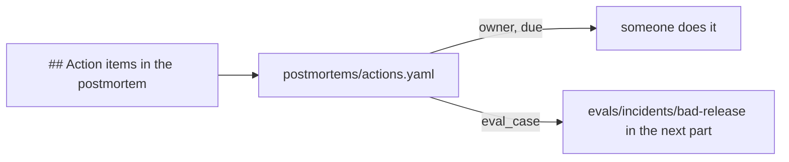

# File the action items

## The problem

A postmortem ends with action items. Then the items stay on the page, and the incident comes back. An item gets done when one team owns it, it has a due point, and a test proves it worked. For example, the first item of the bad release has an owner and an eval case.



## Watch it done

This is the first item of the recorded bad-release incident:

```yaml
- action: Give each audit trail connection back after the booking is written.
  kind: prevent
  owner: booking team
  due: before-next-release
  eval_case: evals/incidents/bad-release
```

Each field has one job. `kind` says how the item helps. `owner` names who does it. `due` says when. `eval_case` names the test that proves it.

## Your turn

Open `postmortems/actions.yaml` in this folder.

1. Set `incident:` to the id of your postmortem.
2. Add one entry under `items:` for each action item of your postmortem. Add at least two.
3. Give each entry these fields:

   | Field       | What to write                                                                              |
   | ----------- | ------------------------------------------------------------------------------------------ |
   | `action`    | one sentence: what changes                                                                 |
   | `kind`      | `prevent` (stops the cause), `detect` (finds it sooner) or `mitigate` (makes it hurt less) |
   | `owner`     | the one team or role that does it                                                          |
   | `due`       | `before-next-release`, `next-planning` or `next-incident-review`                           |
   | `eval_case` | the eval case that proves it, such as `evals/incidents/bad-release`                        |

Keep at least one `prevent` item and one `detect` item. The bad release was caused by a leak, and it was also found late.

## Do it on your work

Move the action items of your own last incident into the file. Pick one `prevent` item and one `detect` item. Good looks like this: each item names a real owner, a due point and an eval case.

## Done when

- The file names your incident and lists at least two items.
- Every item has an action, a kind, a real owner and a due marker.
- Every item names its eval case, and one of them is `evals/incidents/bad-release`.
- There is at least one `prevent` item and one `detect` item.

```bash
bun run verify file-the-action-items
```

Expect: `Done. All 7 rules pass.` and a `Progress:` line.

## Solution

The finished file is in `solution/postmortems/actions.yaml`.

## If you get stuck

| What you see                          | Fix                                                                                         |
| ------------------------------------- | ------------------------------------------------------------------------------------------- |
| `FAIL every item has a real owner`    | `TBD`, `team` and `everyone` do not count. Name one team, such as `platform team`.          |
| `FAIL every item names the eval case` | Write the path of a case, such as `evals/incidents/flapping-page`. A new case name is fine. |
| Every rule fails                      | Check the indents. Each field of an item starts two spaces in from its dash.                |

No world on your machine? Write `bad-release` in `recorded-world.txt` in this folder.

## Words you will use

- **Action item**: one change the team promises after an incident.
- **Owner**: the one team or role that does the item. Shared ownership means nobody does it.
- **Eval case**: a recorded incident with a known right answer. The AI SRE is scored on it.
- **YAML**: a text format for data. Each line is a name, a colon and a value.
