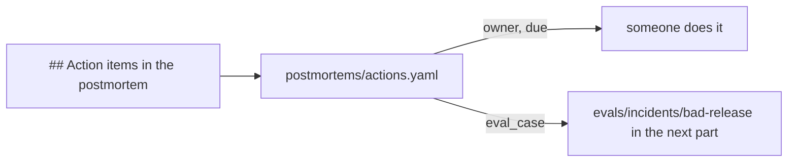

# File the action items

## The problem

A postmortem ends with action items. Then everybody goes back to work, and the items stay on the page. Months later the same incident comes back.

An action item gets done when three things are true. One person or team owns it. It has a point by which it is due. And a test proves it worked. At Gullrock, that test is an eval case: a recorded incident that the AI SRE must get right before anyone trusts a change to it. You build those cases in the next part.

So you move the items out of the page and into a file that a script can read.

For example, this is the first item of the recorded bad-release incident:

```yaml
- action: Give each audit trail connection back after the booking is written.
  kind: prevent
  owner: booking team
  due: before-next-release
  eval_case: evals/incidents/bad-release
```



## Your challenge

Open `postmortems/actions.yaml` in this folder.

1. Set `incident:` to the id of your postmortem.
2. Add one entry under `items:` for each action item of your postmortem. Add at least two.
3. Give each entry these fields:

| Field       | What to write                                                                              |
| ----------- | ------------------------------------------------------------------------------------------ |
| `action`    | one sentence: what changes                                                                 |
| `kind`      | `prevent` (stops the cause), `detect` (finds it sooner) or `mitigate` (makes it hurt less) |
| `owner`     | the one team or role that does it                                                          |
| `due`       | `before-next-release`, `next-planning` or `next-incident-review`                           |
| `eval_case` | the eval case that proves it, such as `evals/incidents/bad-release`                        |

Keep at least one `prevent` item and one `detect` item. The bad release was caused by a leak, and it was also found late.

## Done when

- The file names your incident and lists at least two items.
- Every item has an action, a kind, a real owner and a due marker.
- Every item names its eval case, and one of them is `evals/incidents/bad-release`.
- There is at least one `prevent` item and one `detect` item.

```bash
bun run verify file-the-action-items
```

Expect: `Done. All 7 rules pass.` and a `Progress:` line.

## If you get stuck

| What you see                          | Fix                                                                                         |
| ------------------------------------- | ------------------------------------------------------------------------------------------- |
| `FAIL every item has a real owner`    | `TBD`, `team` and `everyone` do not count. Name one team, such as `platform team`.          |
| `FAIL every item names the eval case` | Write the path of a case, such as `evals/incidents/flapping-page`. A new case name is fine. |
| Every rule fails                      | Check the indents. Each field of an item starts two spaces in from its dash.                |

No world on your machine? Write `bad-release` in `recorded-world.txt` in this folder.

## Words you will use

- **Action item**: one change the team promises after an incident.
- **Owner**: the one team or role that does the item. Shared ownership means nobody does it.
- **Eval case**: a recorded incident with a known right answer. The AI SRE is scored on it.
- **YAML**: a text format for data. Each line is a name, a colon and a value.
