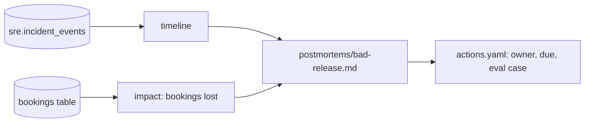

# Write it down without blame

## The problem

An incident that nobody writes up comes back. So after each incident, you write a postmortem. A postmortem is a short report: what happened, what it cost, and what you change so it does not happen again.

A good postmortem is blameless. It names causes in the system, never a person to blame. People then share what really happened.

Two parts of the postmortem come straight from data, so nobody can invent them:

- The **timeline** comes from the audit log of harbour-control, the table `sre.incident_events`. Every line of the timeline matches one row.
- The **Impact** section quotes the number of lost bookings from Postgres.

For example, these are real rows from `sre.incident_events` in the recorded bad-release morning, shortened. Each one becomes a line of the timeline:

```text
04:24:50.656  incident_opened       detector              booking-web error rate 10% over the last minute
04:24:59.816  finding_submitted     ai-sre                release v2 of booking-web
04:25:06.533  remediation_approved  oncall@gullrock.test
04:26:31.682  incident_resolved     harbour-control       Recovery confirmed on a full minute of traffic after the approved change
```

Why it matters: TODO(part session). Cite a company's published postmortem practice with its number. Read it on the day, from the company's own page.

This picture shows where each part of the postmortem comes from:



## Steps

| Step                    | Minutes | You produce                                              | The check reads                                                                 |
| ----------------------- | ------- | -------------------------------------------------------- | ------------------------------------------------------------------------------- |
| `draft-the-timeline`    | 15      | `postmortems/bad-release.md` timeline from the audit log | every timestamp matches an audit row, and nothing in it lacks a row             |
| `write-the-postmortem`  | 25      | the full postmortem                                      | required sections, Impact numbers from Postgres, no person named in Root causes |
| `file-the-action-items` | 10      | `postmortems/actions.yaml`                               | each item has an owner, a due marker and a link to the eval case it adds        |

## Walkthrough

TODO(part session): this part's own session builds the step folders, their checks and these commands.

This command checks the whole part. It has no steps yet.

```bash
bun run verify part write-it-down
```

Expect: `Part write-it-down is done: 0/0 steps pass.` until the part session adds the steps.

```bash
bun run verify draft-the-timeline
```

Expect: TODO(part session): the pass line of `draft-the-timeline`.

```bash
bun run verify write-the-postmortem
```

Expect: TODO(part session): the pass line of `write-the-postmortem`.

```bash
bun run verify file-the-action-items
```

Expect: TODO(part session): the pass line of `file-the-action-items`.
