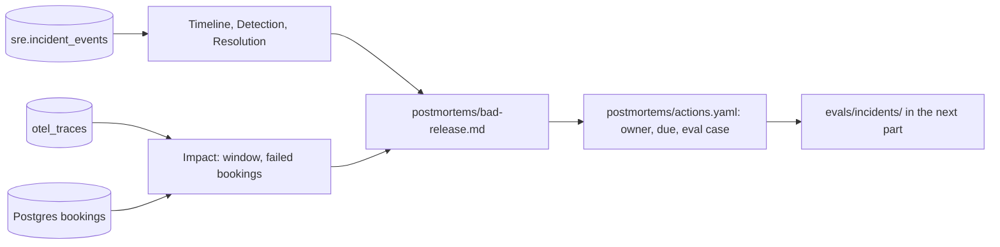

# Write it down without blame

## The problem

An incident that nobody writes up comes back. So after each incident, you write a postmortem. A postmortem is a short report: what happened, what it cost, and what you change so it does not happen again.

A good postmortem is blameless. It names causes in the system, never a person to blame. People then share what really happened.

Three parts of the postmortem come straight from data, so nobody can invent them:

- The **timeline** comes from the audit log of harbour-control, the table `sre.incident_events`. Every line of the timeline matches one row.
- The **Impact** section counts failed bookings from the traces, and bookings that went through from the Postgres bookings table.
- The **action items** go into a file, and each one names the eval case that will prove it worked.

For example, these are real rows from `sre.incident_events` in the recorded bad-release morning. Each one becomes a line of the timeline:

```text
22:17:52  incident_opened       detector              booking-web error rate 10% over the last minute
22:18:01  finding_submitted     ai-sre                Release v2 of booking-web opens a new database connection ...
22:18:08  remediation_approved  oncall@gullrock.test
22:19:33  incident_resolved     harbour-control       Recovery confirmed on a full minute of traffic after the approved change
```

The same records hold a surprise. Release v2 served its first booking at 22:10:35. The page that stayed open came at 22:17:52. So passengers saw errors for more than seven minutes before anyone was paged. A postmortem from memory would start the story at the page.

Why it matters: teams that publish their postmortems teach everyone else. Dan Luu keeps a public list of published postmortems at github.com/danluu/post-mortems. It links 240 write-ups, and 59 of them sit under "Config Errors". We counted them in its README on the build date. Each one exists because a team wrote the incident down instead of moving on.

This picture shows where each part of the postmortem comes from:



## Steps

| Step                    | Minutes | You produce                                              | The check reads                                                                            |
| ----------------------- | ------- | -------------------------------------------------------- | ------------------------------------------------------------------------------------------ |
| `draft-the-timeline`    | 15      | `postmortems/bad-release.md` timeline from the audit log | every timestamp matches an audit row, and nothing in it lacks a row                        |
| `write-the-postmortem`  | 25      | the full postmortem                                      | required sections, Impact numbers from traces and Postgres, no person named in Root causes |
| `file-the-action-items` | 10      | `postmortems/actions.yaml`                               | each item has an owner, a due marker and a link to the eval case it adds                   |

## Walkthrough

You write about an incident that really happened in your world. If you did the orientation or the part "Ask before you act", you already have one. If your world is not running, start it first.

```bash
bun run world
```

Expect: `The world is up: every service is healthy.`

This command lists the newest incidents in the audit log. Pick the one that a rollback fixed.

```bash
bun parts/06-write-it-down/audit-log.ts
```

Expect: `The newest incidents (times are UTC):` and one line per incident, each with an id such as `inc-b1182f037ed0`.

No incident of your own yet? Read the recorded bad-release morning instead. Add `--recorded` to every `audit-log.ts` command. Then write `bad-release` in a file called `recorded-world.txt` in each step's `problem/` folder.

```bash
bun parts/06-write-it-down/audit-log.ts --recorded inc-b1182f037ed0
```

Expect: `Incident inc-b1182f037ed0: 8 audit rows (times are UTC)`, then `Failed bookings: 131 (from the traces)` and `Bookings confirmed: 513 (from the bookings table)`.

First, write the timeline from those rows.

```bash
bun run verify draft-the-timeline
```

Expect: `Done. All 6 rules pass.` once every line matches a row.

Next, write the rest of the postmortem.

```bash
bun run verify write-the-postmortem
```

Expect: `Done. All 8 rules pass.` once every section is there and the numbers match.

Last, file the action items.

```bash
bun run verify file-the-action-items
```

Expect: `Done. All 7 rules pass.` once every item has an owner, a due marker and an eval case.

This command runs all three checks at once.

```bash
bun run verify part write-it-down
```

Expect: `Part write-it-down is done: 3/3 steps pass.`

## The assignment

The problem: nobody writes the incident up, so it comes back.

You hand in `postmortems/bad-release.md` and `postmortems/actions.yaml` in your own repo. Each question is a yes or a no:

1. Does `bun run verify write-the-postmortem` pass: every section, the Impact numbers from the records, and no person named in Root causes?
2. Does every timeline line match an audit row, as `bun run verify draft-the-timeline` shows?
3. Does every action item have an owner, a due marker and an eval case, as `bun run verify file-the-action-items` shows?

Extension for advanced learners: turn one action item into a new eval case in the next part, and show the scorer runs it.

## Finished

You now have a blameless postmortem for a real incident. Its timeline, its window and its counts all come from records, so nobody can argue with them. Its action items live in a file with owners and eval cases.

The next part, "Prove the AI SRE is right", picks up those eval cases. `evals/incidents/bad-release` becomes the first case in an incident set, and you score your AI SRE on every case before you trust a change to it.
