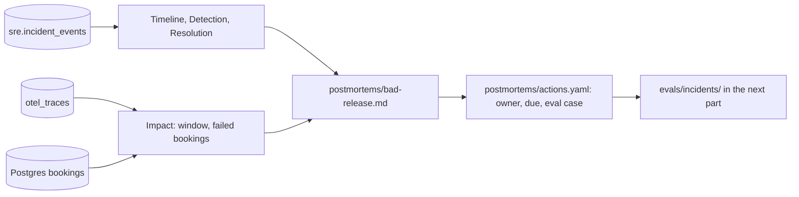

# Write it down without blame

## After this part you can

Write a blameless postmortem from the audit log, and file its action items with owners.

## You leave with

A postmortem in `postmortems/bad-release.md` and action items in `postmortems/actions.yaml`. Both come from real records. Every timeline line matches one audit row. Every action item has an owner, a due marker and an eval case. The next part, "Prove the AI SRE is right", picks up those eval cases.

## The problem

An incident that nobody writes up comes back. So after each incident, you write a postmortem. It is a short report: what happened, what it cost, and what you change.

A good postmortem is blameless. It names causes in the system, never a person. People then say what really happened.

Three parts come straight from data, so nobody can invent them:

- The **timeline** comes from the audit log, the table `sre.incident_events`. Each line matches one row.
- The **Impact** section counts failed bookings from the traces, and confirmed bookings from Postgres.
- The **action items** go in a file. Each one names the eval case that proves it worked.

For example, the records of the recorded bad-release morning hold a surprise. The new release served its first booking at 22:10:35. The page came at 22:17:52. So passengers saw errors for more than seven minutes before anyone was paged. A postmortem from memory would start the story at the page.

Teams that publish their postmortems teach everyone else. Dan Luu keeps a public list of them at github.com/danluu/post-mortems. It links 240 write-ups, and 59 sit under "Config Errors". Each one exists because a team wrote the incident down.

This picture shows where each part of the postmortem comes from:



## Steps

| Step                       | Minutes | You produce                                                     | The check reads                                                                            |
| -------------------------- | ------- | --------------------------------------------------------------- | ------------------------------------------------------------------------------------------ |
| `run-the-incident-command` | 15      | `incident/command.md`: three roles, a state note, timed updates | three people, a status, and updates in time order                                          |
| `draft-the-timeline`       | 15      | `postmortems/bad-release.md` timeline from the audit log        | every timestamp matches an audit row, and nothing in it lacks a row                        |
| `write-the-postmortem`     | 25      | the full postmortem                                             | required sections, Impact numbers from traces and Postgres, no person named in Root causes |
| `file-the-action-items`    | 10      | `postmortems/actions.yaml`                                      | each item has an owner, a due marker and a link to the eval case it adds                   |

## Walkthrough

You write about an incident that really happened in your world. If you did the orientation or the part "Ask before you act", you already have one. If your world is not running, start it first.

```bash
bun run world
```

Expect: `The world is up: every service is healthy.`

This command lists the newest incidents in the audit log. Pick the one that a rollback fixed.

```bash
bun parts/06-write-it-down/audit-log.ts
```

Expect: `The newest incidents (times are UTC):` and one line per incident, each with an id such as `inc-b1182f037ed0`.

No incident of your own yet? Read the recorded bad-release morning instead. Add `--recorded` to every `audit-log.ts` command. Then write `bad-release` in a file called `recorded-world.txt` in each step's `problem/` folder.

```bash
bun parts/06-write-it-down/audit-log.ts --recorded inc-b1182f037ed0
```

Expect: `Incident inc-b1182f037ed0: 8 audit rows (times are UTC)`, then `Failed bookings: 131 (from the traces)` and `Bookings confirmed: 513 (from the bookings table)`.

First, write the timeline from those rows.

```bash
bun run verify draft-the-timeline
```

Expect: `Done. All 7 rules pass.` once every line matches a row.

Next, write the rest of the postmortem.

```bash
bun run verify write-the-postmortem
```

Expect: `Done. All 8 rules pass.` once every section is there and the numbers match.

Last, file the action items.

```bash
bun run verify file-the-action-items
```

Expect: `Done. All 7 rules pass.` once every item has an owner, a due marker and an eval case.

This command runs the checks of every step in the part at once.

```bash
bun run verify part write-it-down
```

Expect: `Part write-it-down is done: 3/3 steps pass.`

## Watch and read

| Kind | Title                       | Author             | Why                                                                  | Link                                     |
| ---- | --------------------------- | ------------------ | -------------------------------------------------------------------- | ---------------------------------------- |
| read | Dan Luu's post-mortems list | Dan Luu, on GitHub | A public list of published postmortems. Read a few to see the shape. | <https://github.com/danluu/post-mortems> |

## Project

Write up one real incident from your own team. Use the audit log and the same three checks. Put the postmortem and the action items in your own repo.

Answer three questions with a yes or a no:

1. Does `bun run verify write-the-postmortem` pass: every section, the Impact numbers from the records, and no person named in Root causes?
2. Does every timeline line match an audit row, as `bun run verify draft-the-timeline` shows?
3. Does every action item have an owner, a due marker and an eval case, as `bun run verify file-the-action-items` shows?

Extension for advanced learners: turn one action item into a new eval case in the next part, and show the scorer runs it.
