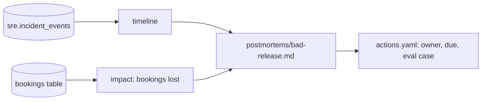

# Write it down without blame

## The problem

An incident nobody writes up comes back. The postmortem's timeline is built from harbour-control's audit log, so it cannot be invented, and its Impact section quotes the bookings lost from Postgres.

Why it matters: TODO(part session): cite a company's published postmortem practice with its number, read on the day from the company's own page.



## Steps

| Step                    | Minutes | You produce                                              | The check reads                                                                 |
| ----------------------- | ------- | -------------------------------------------------------- | ------------------------------------------------------------------------------- |
| `draft-the-timeline`    | 15      | `postmortems/bad-release.md` timeline from the audit log | every timestamp matches an audit row, and nothing in it lacks a row             |
| `write-the-postmortem`  | 25      | the full postmortem                                      | required sections, Impact numbers from Postgres, no person named in Root causes |
| `file-the-action-items` | 10      | `postmortems/actions.yaml`                               | each item has an owner, a due marker and a link to the eval case it adds        |

## Walkthrough

TODO(part session): the step folders, their checks and these commands are built in this part's own session.

```bash
bun run verify part write-it-down
```

Expect: `Part write-it-down is done: 0/0 steps pass.` until the part session adds the steps.

```bash
bun run verify draft-the-timeline
```

Expect: TODO(part session): the pass line of `draft-the-timeline`.

```bash
bun run verify write-the-postmortem
```

Expect: TODO(part session): the pass line of `write-the-postmortem`.

```bash
bun run verify file-the-action-items
```

Expect: TODO(part session): the pass line of `file-the-action-items`.
