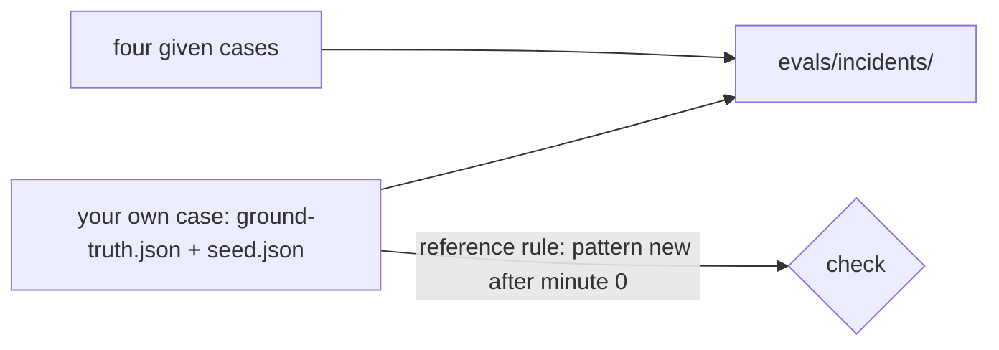

# Build the incident set

## The problem

Your AI SRE got the bad release right once. Does that mean it is good? No. One right answer can be luck. You trust an on-call engineer because of their record on many faults, and the same goes for an AI SRE.

So you collect incidents where you already know the true cause. Each one is an **eval case**: a folder with a `ground-truth.json` that says what really broke, which action fixes it, and which signals only look like the cause. Those signals are **distractors**, or red herrings.

For example, this is part of `evals/incidents/timetable-hang/ground-truth.json`:

```json
"service": "timetable-loader",
"change": { "kind": "none", "value": "" },
"right_action": { "action": "restart_service", "target": "timetable-loader", "params": {} },
"distractors": [{ "signal": "booking-web GET /timetable errors", "why": "booking-web only times out waiting" }]
```

booking-web shows the errors, but timetable-loader is the cause. An agent that blames booking-web fails this case.



## Your challenge

`evals/incidents/` in this folder already holds the four given cases: `bad-release`, `timetable-hang`, `fare-file-push` and `noisy-morning`. Add one case of your own.

1. Rename `evals/incidents/my-case` to a name for your incident, such as `tide-feed-timeout`.
2. Fill in `ground-truth.json`: `scenario` (the folder name), `summary`, `service`, `change`, `pattern`, `right_action` and at least one distractor. `right_action` is `null` or an action from harbour-control's action list.
3. Fill in `seed.json` with the log lines of your incident. Each line has a `minute`, a `service`, a `severity` and a `body`. Minute 0 is when the incident starts. Negative minutes are the quiet time before it.

The check runs the reference rule on your seed: a fault is a log pattern that is new after minute 0. Your pattern must appear in at least three lines of your service from minute 0 on, and in no line before. Your distractor must appear both before and after minute 0, so it looks like a cause but is not new.

An idea: one of your action items from the part "Write it down without blame" names an eval case. Build that one.

## Done when

- The four given cases are there and valid.
- Your own case has a valid `ground-truth.json` and a `seed.json` with lines before and after minute 0.
- Your pattern is new after minute 0, and your distractor shows up before and during the incident.

```bash
bun run verify build-the-incident-set
```

Expect: `Done. All 5 rules pass.` and a `Progress:` line.

## If you get stuck

| What you see                               | Fix                                                                                      |
| ------------------------------------------ | ---------------------------------------------------------------------------------------- |
| `FAIL one case of your own`                | `scenario` must equal the folder name, and `service` is booking-web or timetable-loader. |
| `FAIL the reference rule finds your fault` | Your pattern words also appear before minute 0. Pick words that only the fault writes.   |
| `FAIL your case has a distractor`          | Add lines with the distractor's signal on both sides of minute 0.                        |

## Words you will use

- **Eval case**: one recorded incident with a known right answer.
- **Ground truth**: the right answer of a case, written by a person who knows it.
- **Distractor**: a signal that looks like the cause but is not. It is there before the incident too.
- **Seed**: the log lines that make up a case.
