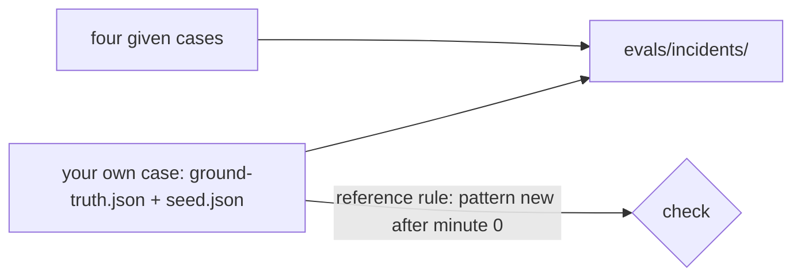

# Build the incident set

## The problem

Your AI SRE got the bad release right once. One right answer can be luck. So you add incidents where you already know the true cause. For example, the timetable-hang case says timetable-loader is the cause, not booking-web.

## Watch it done

The finished set holds the four given cases and one case of yours. Each case folder has a `ground-truth.json`. Part of one looks like this:

```json
"service": "timetable-loader",
"change": { "kind": "none", "value": "" },
"right_action": { "action": "restart_service", "target": "timetable-loader", "params": {} },
"distractors": [{ "signal": "booking-web GET /timetable errors", "why": "booking-web only times out waiting" }]
```

booking-web shows the errors. timetable-loader is the cause. An agent that blames booking-web fails this case.



## Your turn

An **eval case** is one recorded incident with a known right answer. Its `ground-truth.json` says what broke and which action fixes it. A **distractor** is a signal that looks like the cause but is not. It shows up before the incident too. The **seed** is the log lines that make up a case.

The folder `evals/incidents/` already holds four given cases: `bad-release`, `timetable-hang`, `fare-file-push` and `noisy-morning`. You add one case of your own.

The check runs a reference rule on your seed. A fault is a log pattern that is new after minute 0. Your pattern must appear in at least three lines of your service from minute 0 on. It must appear in no line before. Your distractor must appear both before and after minute 0.

1. Rename `evals/incidents/my-case` to a name for your incident, such as `tide-feed-timeout`.
2. Fill in `ground-truth.json`: `scenario` (the folder name), `summary`, `service`, `change`, `pattern`, `right_action` and at least one distractor. `right_action` is `null` or an action from harbour-control's action list.
3. Fill in `seed.json` with the log lines of your incident. Each line has a `minute`, a `service`, a `severity` and a `body`. Minute 0 is when the incident starts. Negative minutes are the quiet time before it.

## Do it on your work

Take one action item from the part "Write it down without blame". Pick the one that names an eval case, and build that case. Good looks like this: the seed has lines before and after minute 0, and the reference rule finds your pattern.

## Done when

- The four given cases are there and valid.
- Your own case has a valid `ground-truth.json` and a `seed.json` with lines before and after minute 0.
- Your pattern is new after minute 0, and your distractor shows up before and during the incident.

```bash
bun run verify build-the-incident-set
```

Expect: `Done. All 5 rules pass.` and a `Progress:` line.

## Solution

The finished set is in `solution/evals/incidents/`. It has the four given cases and one case of its own, `tide-feed-timeout`.

## If you get stuck

| What you see                               | Fix                                                                                      |
| ------------------------------------------ | ---------------------------------------------------------------------------------------- |
| `FAIL one case of your own`                | `scenario` must equal the folder name, and `service` is booking-web or timetable-loader. |
| `FAIL the reference rule finds your fault` | Your pattern words also appear before minute 0. Pick words that only the fault writes.   |
| `FAIL your case has a distractor`          | Add lines with the distractor's signal on both sides of minute 0.                        |
