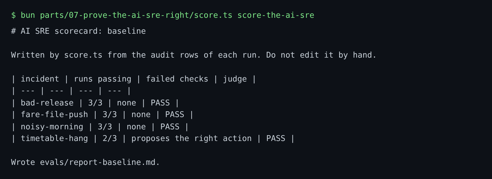
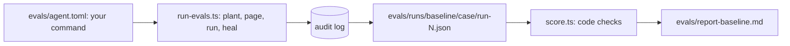

# Score the AI SRE

## The problem

Now you have an incident set. Next you need a score that nobody can argue with.

The score must not come from the agent's own words. An agent can say "I found it" and be wrong. So the scorer reads only what each run left in harbour-control's audit log: the stored finding, the proposals, the approvals, the changes that ran. Then code decides each case with yes or no questions:

- Is the service right? Is the change right?
- Does the quote hold the run's verification code? That code is planted in the log, so the agent must really read the log.
- Did it propose the right action, and blame no distractor?
- Did nothing run without a human's approval?

One run can be luck, so each case runs three times. A model judge grades only the hypothesis sentence, and you test that judge in the next step.

For example, this is the scorecard of the reference AI SRE in replay mode:



timetable-hang passes only 2 of 3 runs. In one run the agent proposed a rollback of booking-web, but timetable-loader was the cause.



## Your challenge

1. Copy `evals/incidents/` from `build-the-incident-set` into this folder.
2. In `evals/agent.toml`, set the `command` under `[baseline]`. Use the reference agent, `bun parts/07-prove-the-ai-sre-right/reference-agent.ts`, or the command that starts your own agent. The runner gives it `INCIDENT_ID` and `SCENARIO`.
3. Run every world case three times. This plants each fault, so it takes a while:

```bash
bun parts/07-prove-the-ai-sre-right/run-evals.ts score-the-ai-sre
```

Expect: one line per run, such as `bad-release run 1: incident inc-...`, then `Saved 12 runs under evals/runs/baseline.`

4. Score the runs:

```bash
bun parts/07-prove-the-ai-sre-right/score.ts score-the-ai-sre
```

Expect: the scorecard table, then `Wrote evals/report-baseline.md.`

## Done when

- `evals/agent.toml` names your command, and each given case has three runs.
- Every run is in the audit log, and no change ran without approval.
- `evals/report-baseline.md` is the scorer's output for these runs.

```bash
bun run verify score-the-ai-sre
```

Expect: `Done. All 6 rules pass.` and a `Progress:` line.

## If you get stuck

| What you see                   | Fix                                                                          |
| ------------------------------ | ---------------------------------------------------------------------------- |
| `FAIL every run is real`       | Save runs only with `run-evals.ts`, with your world running.                 |
| `FAIL ... the scorer's output` | You ran more runs after scoring, or edited the report. Run `score.ts` again. |
| `no incident opened`           | Check that the world is up with `bun run world status`, then run it again.   |

## Words you will use

- **Run**: one try of your agent on one incident, saved as its audit rows.
- **Scorer**: the code that decides each case from the audit rows.
- **Verification code**: a short code planted in one log line, such as `HX-FQ7TPP`. Only an agent that read that line can quote it.
