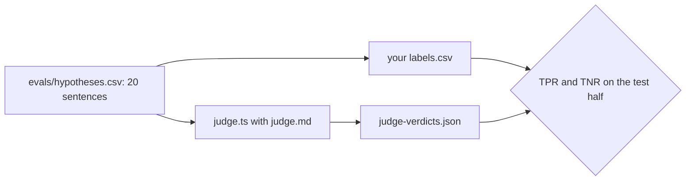

# Check the judge

## The problem

Most of the score comes from code. One question code cannot answer: is the hypothesis sentence right? For that, the scorer asks a model. That model is the **judge**. An LLM (large language model) is the kind of AI model that reads and writes text.

But a judge can be wrong too. If it passes vague sentences, your score looks better than your agent is. So before you trust the judge, you check it against your own labels, using two numbers:

- **TPR** (true positive rate): of the sentences you labelled Pass, the share the judge passed.
- **TNR** (true negative rate): of the sentences you labelled Fail, the share the judge failed.

You split the sentences into two halves. You may look at the **dev** half as often as you like, and change the judge's prompt. You measure the **test** half once, at the end. Both numbers must be at least 0.9 on the test half.

For example, here are two sentences about the bad release:

```text
h01  Release v2 of booking-web opens a new database connection for each booking's
     audit trail and never returns it, so the two audit connections run out.     -> Pass
h19  Release v2 of booking-web is bad.                                            -> Fail
```

h19 names the service and the release, but not why it fails. The recorded judge passes it anyway. That is a judge mistake, and it sits in the dev half, where you are meant to find it.



## Your challenge

1. Read the 20 sentences in `evals/hypotheses.csv`. Each has an id, a case and a half (`dev` or `test`). The summary of each case is in `world/scenarios/<case>.json`.
2. In `evals/labels.csv`, write `Pass` or `Fail` after each id. A sentence passes when it names the right service, the right change (or says nothing changed), and why it fails.
3. Run the judge:

```bash
bun parts/07-prove-the-ai-sre-right/judge.ts check-the-judge
```

Expect: `Judged 20 sentences (replay mode). Wrote evals/judge-verdicts.json.` and the dev half rates.

4. Read each dev sentence where you and the judge disagree. With a live provider, make `evals/judge.md` clearer and judge again. In replay mode, the verdicts are recorded, so look at the reasons only.

## Done when

- All 20 sentences carry your label, and the test half has at least three of each.
- `evals/judge-verdicts.json` is the judge's own output.
- On the test half, TPR and TNR are both at least 0.9.

```bash
bun run verify check-the-judge
```

Expect: `Done. All 5 rules pass.` and a `Progress:` line.

## If you get stuck

| What you see                                  | Fix                                                                                                   |
| --------------------------------------------- | ----------------------------------------------------------------------------------------------------- |
| `FAIL ... at least three Pass and three Fail` | You passed almost everything. A sentence with only a symptom, such as "Prices are wrong.", is a Fail. |
| `FAIL ... (TPR)`                              | You passed a sentence the judge failed. Read it again: does it say why?                               |
| `FAIL ... holds the judge's verdict`          | Run `judge.ts` again, and never edit its output.                                                      |

## Words you will use

- **Judge**: a model that answers one yes or no question about an answer.
- **Label**: your own Pass or Fail on one sentence.
- **Dev half and test half**: the sentences you tune on, and the ones you measure once at the end.
