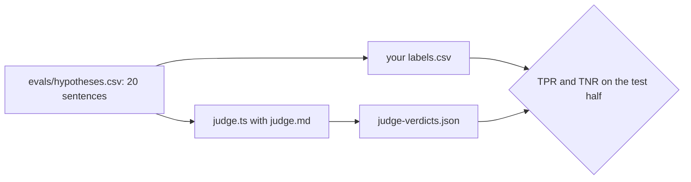

# Check the judge

## The problem

A judge can be wrong too. If it passes vague sentences, your score looks better than your agent is. For example, the recorded judge passes sentence h19. It names the service and the release, but not why it fails.

## Watch it done

Two sentences about the bad release look like this. h01 is a Pass. h19 is a Fail:

```text
h01  Release v2 of booking-web opens a new database connection for each booking's
     audit trail and never returns it, so the two audit connections run out.     -> Pass
h19  Release v2 of booking-web is bad.                                            -> Fail
```

The judge passes h19 anyway. That is a judge mistake, and it sits in the dev half, where you are meant to find it.



## Your turn

Most of the score comes from code. One question code cannot answer: is the hypothesis sentence right? A model called the **judge** answers it. An LLM (large language model) is an AI model that reads and writes text.

You check the judge with two numbers:

- **TPR** (true positive rate): of the sentences you labelled Pass, the share the judge passed.
- **TNR** (true negative rate): of the sentences you labelled Fail, the share the judge failed.

You split the sentences into a **dev** half and a **test** half. Tune on dev as often as you like. Measure the **test** half once, at the end. Both numbers must be at least 0.9 there.

1. Read the 20 sentences in `evals/hypotheses.csv`. Each has an id, a case and a half (`dev` or `test`). The summary of each case is in `world/scenarios/<case>.json`.
2. In `evals/labels.csv`, write `Pass` or `Fail` after each id. A sentence passes when it names the right service and the right change. It must also say why the fault happens.
3. Run the judge:

```bash
bun parts/07-prove-the-ai-sre-right/judge.ts check-the-judge
```

Expect: `Judged 20 sentences (replay mode). Wrote evals/judge-verdicts.json.` and the dev half rates.

4. Read each dev sentence where you and the judge disagree. With a live provider, make `evals/judge.md` clearer and judge again. In replay mode, the verdicts are recorded, so look at the reasons only.

## Do it on your work

Write 20 sentences about your own agent's last incident, and label each one Pass or Fail. Good looks like this: you can say why each Fail fails, and the judge agrees with you on the test half.

## Done when

- All 20 sentences carry your label, and the test half has at least three of each.
- `evals/judge-verdicts.json` is the judge's own output.
- On the test half, TPR and TNR are both at least 0.9.

```bash
bun run verify check-the-judge
```

Expect: `Done. All 5 rules pass.` and a `Progress:` line.

## Solution

The finished labels, sentences and verdicts are in `solution/evals/`. Look at `solution/evals/labels.csv` and `solution/evals/judge-verdicts.json`.

## If you get stuck

| What you see                                  | Fix                                                                                                   |
| --------------------------------------------- | ----------------------------------------------------------------------------------------------------- |
| `FAIL ... at least three Pass and three Fail` | You passed almost everything. A sentence with only a symptom, such as "Prices are wrong.", is a Fail. |
| `FAIL ... (TPR)`                              | You passed a sentence the judge failed. Read it again: does it say why?                               |
| `FAIL ... holds the judge's verdict`          | Run `judge.ts` again, and never edit its output.                                                      |
