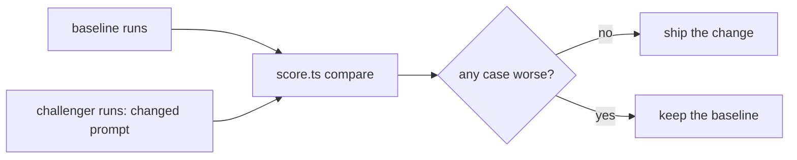

# Gate the prompt change

## The problem

The reference agent passed timetable-hang in only 2 of 3 runs. A prompt change can fix that case and break another one. For example, a fix could make the agent too shy to roll back the bad release.

## Watch it done

A good comparison looks like this. Each row is one case, and the change column shows the difference in passing runs:

```text
| incident       | baseline | challenger | change |
| bad-release    | 3/3      | 3/3        | 0      |
| noisy-morning  | 3/3      | 3/3        | 0      |
| timetable-hang | 2/3      | 3/3        | 1      |
```



## Your turn

Every change is a **challenger**. It runs on the same cases as the **baseline**, three times each. It is accepted only if no case gets worse. That test is a **gate**: a check a change must pass before it ships.

In replay mode the model's replies are recorded, so a prompt change does not change them. To see a real change, set a live provider in `.env`.

1. Copy `evals/runs/baseline/` and `evals/incidents/` from `score-the-ai-sre` into this folder.
2. Write your changed prompt in `evals/challenger-prompt.md`. For example, tell the agent to check that a release changed before it proposes a rollback.
3. In `evals/agent.toml`, set the `[challenger]` command. For the reference agent, it is the baseline command plus `--prompt evals/challenger-prompt.md`. Or change your own agent's prompt or tools.
4. Run the challenger, then compare.

```bash
bun parts/07-prove-the-ai-sre-right/run-evals.ts gate-the-prompt-change challenger
```

Expect: one line per run, then `Saved 12 runs under evals/runs/challenger.`

```bash
bun parts/07-prove-the-ai-sre-right/score.ts gate-the-prompt-change compare
```

Expect: the table above, then `Wrote evals/compare.md.`

## Do it on your work

Change the prompt of your own agent. Run the challenger three times on each case, the same as the baseline. Good looks like this: no case gets worse in `evals/compare.md`.

## Done when

- `evals/agent.toml` has a `[challenger]` command that differs from `[baseline]`.
- Every case has three challenger runs, and every run is in the audit log.
- `evals/compare.md` is the scorer's output, and no case passes fewer runs than before.

```bash
bun run verify gate-the-prompt-change
```

Expect: `Done. All 5 rules pass.` and a `Progress:` line.

## Solution

The finished challenger prompt and comparison are in `solution/evals/`. See `solution/evals/challenger-prompt.md` and `solution/evals/compare.md`.

## If you get stuck

| What you see                                    | Fix                                                                             |
| ----------------------------------------------- | ------------------------------------------------------------------------------- |
| `FAIL no incident passes fewer runs`            | Your change broke a case. Read its failed checks, change the prompt, run again. |
| `FAIL every incident ... has 3 challenger runs` | Run the challenger three times per case, the same as the baseline.              |

## Words you will use

- **Baseline**: the agent you trust today, and its score.
- **Challenger**: the changed agent you want to ship.
- **Gate**: a test a change must pass before it ships. Here: no case gets worse.
