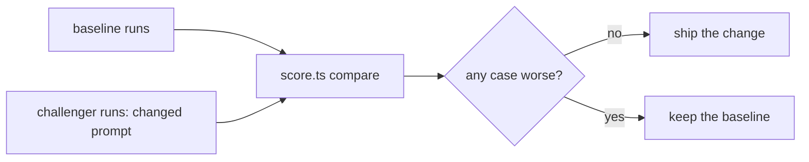

# Gate the prompt change

## The problem

Your baseline scorecard showed a weak spot. For example, the reference agent passed timetable-hang in only 2 of 3 runs. Once it proposed a rollback of booking-web, but no release had changed.

So you change the agent's prompt. A prompt change can fix one case and quietly break another. A fix for timetable-hang could make the agent too shy to roll back the bad release.

So every change is a **challenger**. It runs on the same cases as the **baseline**, three times each, and it is accepted only if no case gets worse. That is a **gate**: a test the change must pass before it ships.

For example, a good comparison looks like this:

```text
| incident       | baseline | challenger | change |
| bad-release    | 3/3      | 3/3        | 0      |
| noisy-morning  | 3/3      | 3/3        | 0      |
| timetable-hang | 2/3      | 3/3        | 1      |
```



## Your challenge

1. Copy `evals/runs/baseline/` and `evals/incidents/` from `score-the-ai-sre` into this folder.
2. Write your changed prompt in `evals/challenger-prompt.md`. For example, tell the agent to check that a release changed before it proposes a rollback.
3. In `evals/agent.toml`, set the `[challenger]` command. For the reference agent, it is the baseline command plus `--prompt evals/challenger-prompt.md`. Or change your own agent's prompt or tools.
4. Run the challenger, then compare:

```bash
bun parts/07-prove-the-ai-sre-right/run-evals.ts gate-the-prompt-change challenger
```

Expect: one line per run, then `Saved 12 runs under evals/runs/challenger.`

```bash
bun parts/07-prove-the-ai-sre-right/score.ts gate-the-prompt-change compare
```

Expect: the table above, then `Wrote evals/compare.md.`

In replay mode the model's replies are recorded, so a prompt change does not change them. To see a real change, set a live provider in `.env`.

## Done when

- `evals/agent.toml` has a `[challenger]` command that differs from `[baseline]`.
- Every case has three challenger runs, and every run is in the audit log.
- `evals/compare.md` is the scorer's output, and no case passes fewer runs than before.

```bash
bun run verify gate-the-prompt-change
```

Expect: `Done. All 5 rules pass.` and a `Progress:` line.

## If you get stuck

| What you see                                    | Fix                                                                             |
| ----------------------------------------------- | ------------------------------------------------------------------------------- |
| `FAIL no incident passes fewer runs`            | Your change broke a case. Read its failed checks, change the prompt, run again. |
| `FAIL every incident ... has 3 challenger runs` | Run the challenger three times per case, the same as the baseline.              |

## Words you will use

- **Baseline**: the agent you trust today, and its score.
- **Challenger**: the changed agent you want to ship.
- **Gate**: a test a change must pass before it ships. Here: no case gets worse.
