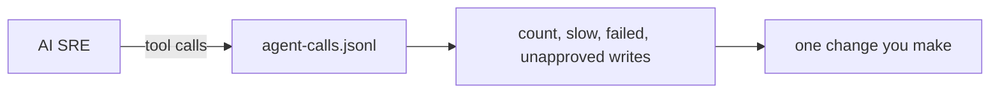

# Observe the agent's own calls

## The problem

You watch your services. You should also watch the AI SRE. It makes tool calls, and some of them fail, run slow or change things. If you do not look at them, you will not see a write that nobody approved. For example, one write that ran with no approval is worth a fix on the same day.



## Watch it done

Each line of `agent-calls.jsonl` is one call. It has the tool, whether it reads or writes, whether it worked, how long it took, and whether a person approved it. A write that is not approved is the line to worry about.

## Your challenge

Open `answers/observe-the-agents-calls.md` in this folder.

1. Count the lines:

```bash
wc -l agent-calls.jsonl
```

Expect: `6 agent-calls.jsonl`.

2. Count the calls that failed, and write the number after `Failed calls:`.
3. Find the slowest call and write its tool after `Slowest tool:`.
4. Count the write calls that were not approved, and write the number after `Writes without approval:`.
5. Write one change you would make after `Action:`.

```bash
bun run verify observe-the-agents-calls
```

Expect: `Done. All 5 rules pass.` and a `Progress:` line.

## Do it on your work

Look at the last run of your own agent. Count the same four things. Good looks like this: every write has an approval next to it, or you have a change that stops it.

## Done when

- The counts match the file.
- The slowest tool is named.
- You wrote one change in a full sentence.

## If you get stuck

| What you see                        | Fix                                                                          |
| ----------------------------------- | ---------------------------------------------------------------------------- |
| `FAIL Writes without approval`      | Count a write when `approved` is `false` or `null`. Only `true` is approved. |
| `FAIL Calls is the number of lines` | Write only the number, with no other words.                                  |

## Words you will use

- **Tool call**: one request the agent makes to a tool.
- **Write call**: a call that changes something, as opposed to one that only reads.
- **Approval**: a person's yes before a write runs.
