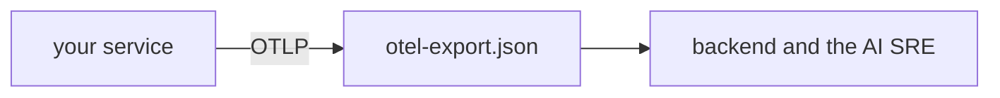

# Send your own OTel data

## The problem

The AI SRE can only reason about data it can read. A service that sends no name, no release and plain span names gives it nothing to work with. OTel is the open standard for sending traces, metrics and logs. For example, a span named only GET tells nobody which page was slow.



## Watch it done

The starter export has the service name `unknown_service`, no version, a span named only `GET`, and an email in an attribute. The solution fixes all four.

## Your challenge

Open `otel-export.json` in this folder.

1. Set the `service.name` to a real name.
2. Add a `service.version` next to it.
3. Rename the span `GET` after its route, such as `GET /checkin`.
4. Remove the email attribute.

```bash
bun run verify send-your-own-otel-data
```

Expect: `Done. All 7 rules pass.` and a `Progress:` line.

## Do it on your work

Point a small service of your own at a collector, make one request, and save the export in this file. Good looks like this: the backend shows your service name, your release, and one trace with a parent and a child.

## Done when

- The service has a name and a version.
- The ids and span names look right.
- No email address is in the data.

## If you get stuck

| What you see                          | Fix                                                                |
| ------------------------------------- | ------------------------------------------------------------------ |
| `FAIL service.name is set`            | Set the `OTEL_SERVICE_NAME` variable before you start the service. |
| `FAIL at least one span has a parent` | Make a request that calls a database or another service.           |

## Words you will use

- **OTLP**: the format OTel uses to send data.
- **Resource**: facts about the service, such as its name and version.
- **Span**: one timed piece of work inside a trace.
