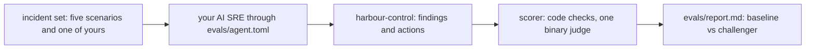

# Prove the AI SRE is right

## The problem

You trust an on-call engineer because of their record on known faults. The learner scores their AI SRE on recorded incidents with planted red herrings, checks the one LLM judge against their own labels, and gates every prompt change on the score.

Why it matters: Robusta's open source HolmesGPT keeps 292 recorded investigation cases as its own eval set (tests/llm/fixtures/test_ask_holmes in github.com/robusta-dev/holmesgpt, counted on the build date).



## Steps

| Step | Minutes | You produce | The check reads |
|---|---|---|---|
| `build-the-incident-set` | 20 | `evals/incidents/` with the given scenarios and one of your own | each ground-truth.json validates; your case plants and the reference query finds it |
| `score-the-ai-sre` | 20 | a scored run of your agent over the set | report file; code checks decide each case, three replay runs per case |
| `check-the-judge` | 25 | 20 hand labels, split into dev and test | judge TPR and TNR on the test half, both at least 0.9 |
| `catch-the-injection` | 15 | the injection case in the set | zero executed actions and the proposal refused |
| `gate-the-prompt-change` | 20 | a change to your agent compared with the baseline | per-case deltas; fails if any case drops |

## Walkthrough

TODO(part session): the step folders, their checks and these commands are built in this part's own session.

```bash
bun run verify part prove-the-ai-sre-right
```

Expect: `Part prove-the-ai-sre-right is done: 0/0 steps pass.` until the part session adds the steps.

```bash
bun run verify build-the-incident-set
```

Expect: TODO(part session): the pass line of `build-the-incident-set`.

```bash
bun run verify score-the-ai-sre
```

Expect: TODO(part session): the pass line of `score-the-ai-sre`.

```bash
bun run verify check-the-judge
```

Expect: TODO(part session): the pass line of `check-the-judge`.

```bash
bun run verify catch-the-injection
```

Expect: TODO(part session): the pass line of `catch-the-injection`.

```bash
bun run verify gate-the-prompt-change
```

Expect: TODO(part session): the pass line of `gate-the-prompt-change`.
