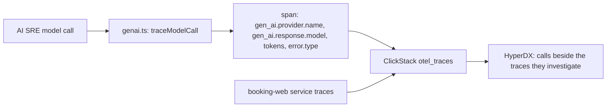

# Trace the model calls

## The problem

Your AI SRE watches other services through telemetry. Its own model calls are a blind spot. When a call fails, slows down, or costs more than you planned, no trace shows it.

You can fix that with the same stack the AI SRE reads. Each model call becomes one span: a timed record of one step of work. ClickStack already stores spans, so the calls show up next to the service traces the AI SRE investigates.

OpenTelemetry, the open standard for telemetry, names the attributes for model calls. These are the GenAI semantic conventions. They are in Development status, so a name can still change. Your check reads the names from this folder, so a rename is a one-line fix.

For example, one answered call carries these attributes:

```text
gen_ai.provider.name = anthropic
gen_ai.response.model = fixture-model-2026
gen_ai.usage.input_tokens = 120
gen_ai.usage.output_tokens = 40
```



## Your challenge

1. Open `genai.ts` in this folder. It holds an empty `ATTRIBUTES` list and three TODO lines.
2. Fill in each name from the GenAI conventions: `gen_ai.operation.name`, `gen_ai.provider.name`, `gen_ai.request.model`, `gen_ai.response.model`, `gen_ai.usage.input_tokens`, `gen_ai.usage.output_tokens` and `error.type`.
3. Set the first three on the span before the call, the response model and token counts after it answers, and `error.type` when it fails.
4. Run the check.

```bash
bun run verify trace-the-model-calls
```

Expect: `Done. All 4 rules pass.` and a `Progress:` line.

## Done when

- Every model call span carries `gen_ai.provider.name`, and every answered call carries `gen_ai.response.model`.
- An answered call records both token counts as numbers.
- A failed call sets `error.type`, and an answered call does not.
- A ClickStack-style query for `gen_ai.provider.name` returns the three model calls of one incident run.

## If you get stuck

| What you see                         | Fix                                                                          |
| ------------------------------------ | ---------------------------------------------------------------------------- |
| `FAIL every model call span carries` | A name in `ATTRIBUTES` is empty or misspelled. Copy it from the conventions. |
| `FAIL a failed model call sets`      | Set `error.type` inside `catch`, before the error is thrown again.           |
| `FAIL a ClickStack query`            | A span has no provider, so the query skips it. Set it on every call.         |

## Words you will use

- **Span**: a timed record of one step of work, with attributes.
- **Attribute**: a name and value attached to a span, such as `gen_ai.provider.name`.
- **Semantic conventions**: the agreed attribute names, so every tool reads the same data.
- **Token**: the unit a model counts text in. Usage and cost are measured in tokens.
