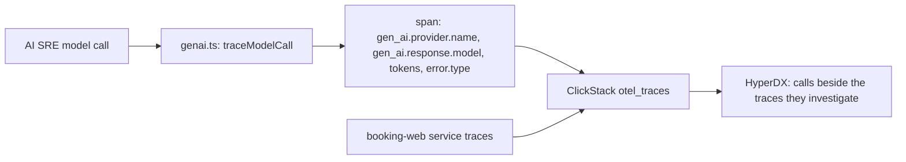

# Trace the model calls

## The problem

Your AI SRE watches other services. Its own model calls are a blind spot. For example, one answered call uses 120 input tokens and 40 output tokens, and no trace shows it. You fix that with a span for each call.

## Watch it done

Before, a model call leaves no trace. After, each call is one span, a timed record of one step of work. ClickStack stores spans, so the calls sit beside the service traces. One answered call carries these attributes:

```text
gen_ai.provider.name = anthropic
gen_ai.response.model = fixture-model-2026
gen_ai.usage.input_tokens = 120
gen_ai.usage.output_tokens = 40
```

The names come from OpenTelemetry, the open standard for telemetry. They are in Development status, so a name can change. Your check reads the names from this folder, so a rename is a one-line fix.



## Your turn

1. Open `genai.ts` in this folder. It holds an empty `ATTRIBUTES` list and three TODO lines.
2. Fill in each name from the GenAI conventions: `gen_ai.operation.name`, `gen_ai.provider.name`, `gen_ai.request.model`, `gen_ai.response.model`, `gen_ai.usage.input_tokens`, `gen_ai.usage.output_tokens` and `error.type`.
3. Set the first three on the span before the call. Set the response model and token counts after it answers. Set `error.type` when it fails.
4. Run the check.

```bash
bun run verify trace-the-model-calls
```

Expect: `Done. All 4 rules pass.` and a `Progress:` line.

## Do it on your work

Pick one model call in your own service. Add the three names before the call, and `error.type` in its error path. Good looks like: a query in your ClickStack returns that call with its provider name.

## Done when

- Every model call span carries `gen_ai.provider.name`, and every answered call carries `gen_ai.response.model`.
- An answered call records both token counts as numbers.
- A failed call sets `error.type`, and an answered call does not.
- A ClickStack-style query for `gen_ai.provider.name` returns the three model calls of one incident run.

## Solution

The finished helper is in `solution/genai.ts`.

## If you get stuck

| What you see                         | Fix                                                                          |
| ------------------------------------ | ---------------------------------------------------------------------------- |
| `FAIL every model call span carries` | A name in `ATTRIBUTES` is empty or misspelled. Copy it from the conventions. |
| `FAIL a failed model call sets`      | Set `error.type` inside `catch`, before the error is thrown again.           |
| `FAIL a ClickStack query`            | A span has no provider, so the query skips it. Set it on every call.         |

## Words you will use

- **Span**: a timed record of one step of work, with attributes.
- **Attribute**: a name and value attached to a span, such as `gen_ai.provider.name`.
- **Semantic conventions**: the agreed attribute names, so every tool reads the same data.
- **Token**: the unit a model counts text in. Usage and cost are measured in tokens.
