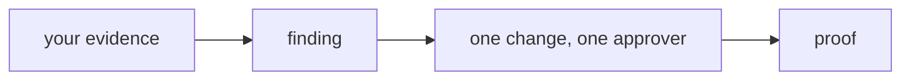

# Do it on your own service

## The problem

Everything so far ran on the Harbour world. A skill is only yours when it works on something you run. Here you review one real incident from your own service, and a check reads your file, not the course. For example, a payments team can show a log line and a deploy that went out just before it.



## Watch it done

Open `incident-review.md` in the `solution` folder. It is about a made-up payments service. Each evidence line has a source, a place and a time. The change has one person who must say yes.

## Your challenge

Open `incident-review.md` in this folder.

1. Write the name of a service you run after `Service:`. Do not use a course name.
2. Under `## Evidence`, write at least two lines with two kinds of source, such as a log and a deploy. Use the form `- log | where you looked | 2026-03-02 14:05`.
3. Write the finding, one change, who approves it, and how you will know it worked.

```bash
bun run verify do-it-on-your-own-service
```

Expect: `Done. All 7 rules pass.` and a `Progress:` line.

## Do it on your work

This whole step is on your work. Good looks like this: someone on your team can open each evidence line and find the same thing you saw.

## Done when

- The review names your own service.
- The evidence has two lines with two kinds of source.
- The finding, change, approver and proof are each one clear sentence.

## If you get stuck

| What you see                                   | Fix                                                                 |
| ---------------------------------------------- | ------------------------------------------------------------------- |
| `FAIL the Service line names your own service` | Remove any course name, such as `booking-web`, from the whole file. |
| `FAIL the evidence uses at least two kinds`    | Add a deploy, metric or trace line next to the log line.            |

## Words you will use

- **Evidence**: something a reader can look up, with its place and time.
- **Approver**: the person who must say yes before the change runs.
- **Proof**: the sign that tells you the fix worked.
