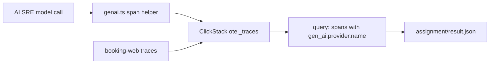

# Trace model calls with ClickStack

## After this part you can

Give each model call a span, and find a failed call in ClickStack with one query.

## You leave with

A `genai.ts` helper that sets the GenAI attribute names. You also leave with `assignment/result.json` from the homework check, and an `incident-review.md` about a service you run.

## The problem

Your AI SRE reads telemetry about other services. Its own model calls leave no trace. Give each call a span, with the OpenTelemetry GenAI names, in the ClickStack you already run.

A model call is a service call like any other. It fails, it is slow, and it costs money. For example, a rate limit error from the provider ends one investigation early. With `error.type` set to `RateLimitError`, you find the cause in one query.

Langfuse, Arize Phoenix and ClickStack all read these names. So your spans move with you if you change tools.



## What we teach

- The five attributes that describe one model call: provider, response model, input tokens, output tokens, error type.
- That a failed call must leave a trace too, with `error.type`.
- That the names are in Development status, and how to keep them in one file so a rename costs one edit.

This part is short and optional in the live session. It is expected as homework. Nothing earlier in the course changes.

## Steps

| Step                        | Minutes | You produce                                  | The check reads                                                 |
| --------------------------- | ------- | -------------------------------------------- | --------------------------------------------------------------- |
| `trace-the-model-calls`     | 20      | `genai.ts`                                   | the spans of one pretend incident, and a ClickStack-style query |
| `do-it-on-your-own-service` | 20      | `incident-review.md` about a service you run | the shape, two kinds of evidence, and no course names           |

## Walkthrough

See the finished helper pass the check. The reference solution lives in this step's `solution/` folder, like every other solution in the course.

```bash
bun run verify trace-the-model-calls solution
```

Expect: `Done. All 4 rules pass.`

Now check your own work. It fails on the untouched starter and passes once your attributes are right.

```bash
bun run verify trace-the-model-calls
```

Expect: four `FAIL` lines on the starter, then `Done. All 4 rules pass.` when you finish.

Run the homework check. It writes `assignment/result.json`.

```bash
bun assignment/check.ts
```

Expect: `All Done-when lines pass. Wrote assignment/result.json.` once `assignment/genai.ts` is right.

Run the whole part.

```bash
bun run verify part trace-model-calls-with-clickstack
```

Expect: `Part trace-model-calls-with-clickstack is done: 1/1 steps pass.`

## Options

You can also send the same spans to Langfuse, a trace store built for model work.

- **Choose when**: your team wants prompt management and annotation queues next to the traces.
- **Trade-off**: its stack needs about 2.3 GiB more memory, in seven containers, so a small laptop feels it.

ClickStack is the pick here because you already run it. The assignment's `CHOICE.md` asks you to write down when Langfuse would be worth the memory.

## Watch and read

No picks are listed for this part yet.

## Project

Pick one model call in your own service. Give it the span names from this part. Run a ClickStack query that finds that call by its provider name. Then go back to the root README and run the finished loop once more.
