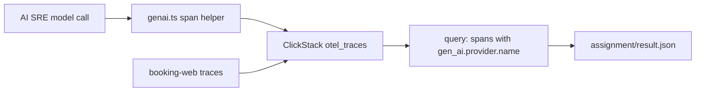

# Trace model calls with ClickStack

## The problem

You built every idea in this course by hand first. Now you redo one of them with the standard teams use in production.

Your AI SRE reads telemetry about other services. Its own model calls leave no trace. In this part you give each call a span, using the OpenTelemetry GenAI names, in the ClickStack you already run.

This part is short and optional in the live session. It is expected as homework. Nothing earlier in the course changes.



## Why it matters

A model call is a service call like any other. It fails, it is slow, and it costs money. If it has no span, you debug your debugger by guessing.

For example, a rate limit error from the provider ends one investigation early. With `error.type` set to `RateLimitError`, you find the cause in one query.

Shared names matter too. Langfuse, Arize Phoenix and ClickStack all read the OpenTelemetry GenAI names, so your spans move with you if you change tools.

## What we teach

- The five attributes that describe one model call: provider, response model, input tokens, output tokens, error type.
- That a failed call must leave a trace too, with `error.type`.
- That the names are in Development status, and how to keep them in one file so a rename costs one edit.

## Steps

| Step                    | Minutes | You produce | The check reads                                                 |
| ----------------------- | ------- | ----------- | --------------------------------------------------------------- |
| `trace-the-model-calls` | 20      | `genai.ts`  | the spans of one pretend incident, and a ClickStack-style query |

## Walkthrough

See the finished helper pass the check. The reference solution lives in this step's `solution/` folder, like every other solution in the course.

```bash
bun run verify trace-the-model-calls solution
```

Expect: `Done. All 4 rules pass.`

Now check your own work. It fails on the untouched starter and passes once your attributes are right.

```bash
bun run verify trace-the-model-calls
```

Expect: four `FAIL` lines on the starter, then `Done. All 4 rules pass.` when you finish.

Run the homework check. It writes `assignment/result.json`.

```bash
bun assignment/check.ts
```

Expect: `All Done-when lines pass. Wrote assignment/result.json.` once `assignment/genai.ts` is right.

Run the whole part.

```bash
bun run verify part trace-model-calls-with-clickstack
```

Expect: `Part trace-model-calls-with-clickstack is done: 1/1 steps pass.`

## Options

You can also send the same spans to Langfuse, a trace store built for model work.

- **Choose when**: your team wants prompt management and annotation queues next to the traces.
- **Trade-off**: its stack needs about 2.3 GiB more memory, in seven containers, so a small laptop feels it.

ClickStack is the pick here because you already run it. The assignment's `CHOICE.md` asks you to write down when Langfuse would be worth the memory.

## Finished

Your AI SRE is now observable with the same stack it observes. The hand-built parts before this one are untouched. Go back to the root README and run the finished loop once more.
